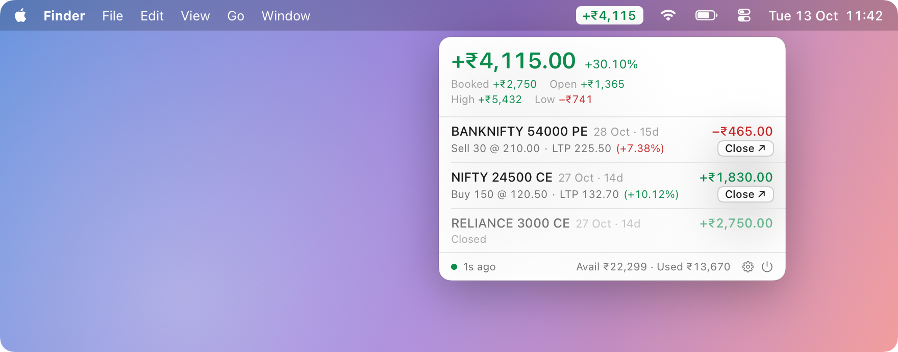
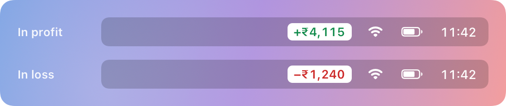

<div align="center">


# Chillar

**Your F&O P&L, always one glance away in the macOS menu bar.**

*Chillar* (n.): Indian English for loose change. How much chillar did the market give you today?


[](https://github.com/AbhinavVasudevan/chillar/actions/workflows/ci.yml)



<sub>Screenshot uses made-up sample data.</sub>

</div>

---

Trading options means checking your P&L constantly. Chillar puts the number in your menu bar, green
for profit and red for loss, so you can keep working and still know where you stand. Click it for a
compact panel with every position.

It's a small, native Mac app with no dependencies, no servers, no analytics, and read-only access by default.

## Features



- **Live P&L in the menu bar**, on a white pill that's readable on any wallpaper.
- **Position panel:** underlying, strike, CE/PE, expiry with days left, qty, avg → LTP, % move and P&L.
- **Day summary:** booked vs open P&L, today's high and low, return on margin, and available and used funds.
- **Smart refresh:** every second while the market is open, every 30s in pre-open and during closing-price
  settlement, every 15 min after hours. Opening the panel or waking the Mac refreshes instantly.
- **No daily token pasting:** the broker session renews itself while the app runs.
- **Optional quick exit** (experimental, off by default): close an F&O position from the panel with a capped limit order.

<br clear="right">

## Brokers

| Broker | Status |
|---|---|
| [Dhan](https://dhan.co) | ✅ Supported (free Trading APIs; live LTP if you have Data APIs) |
| Zerodha (Kite Connect) | Planned |
| Upstox | Planned |
| Angel One (SmartAPI) | Planned |

Want your broker? Each one is a single adapter file. See [Adding a broker](#adding-a-broker).

## Install

Requires macOS 14+ and the Xcode Command Line Tools (`xcode-select --install`).

```sh
git clone https://github.com/AbhinavVasudevan/chillar.git
cd chillar
./scripts/create-signing-cert.sh   # once: creates a local code-signing identity
./build.sh install                 # builds, installs to /Applications and launches
```

Each build asks to let `codesign` use the key. Enter your login password and click **Allow**.
[Why?](#security)

Then:

1. On **web.dhan.co → My Profile → Access DhanHQ APIs**, generate an access token.
2. Click **₹ —** in the menu bar, enter your Client ID and the token, and click **Save**.
3. That's it. Chillar adds itself to **Login Items** on first launch, so it starts with your Mac and
   keeps the token renewed. You can turn this off in Settings.

If the Mac is off for more than 24 hours the token expires. Paste a new one in Settings.

## Security

Chillar has access to a trading account, so it's built to hold as little as possible and to be
**read-only unless you opt in**.

| | |
|---|---|
| **Token storage** | Login Keychain only (not iCloud-synced), readable by apps signed with your local Chillar identity. The saved token is never shown again in the UI. Like any login-keychain item, it is included in Time Machine and Migration Assistant copies of your keychain. |
| **Signing key** | `create-signing-cert.sh` creates a non-extractable key that doesn't pre-authorise `codesign`, so every build asks for permission. Click **Allow**, not Always Allow. An unexpected prompt means something is trying to impersonate the app. |
| **Network** | HTTPS to the broker's API host only, enforced on every request, TLS 1.2+. Redirects are refused so credentials can't leak to another host. Ephemeral session: no disk cache, no cookies; 20s total request timeout. No analytics, no third-party servers. |
| **Sandbox** | App Sandbox (outgoing network only) and hardened runtime. It can't read your files. |
| **On disk** | Only preferences and today's high/low P&L, inside the sandbox container. |
| **Token renewal** | Runs in its own task that nothing cancels mid-rotation. If a renewal fails, the app checks whether the old token still works and tells you if it doesn't. |
| **Dependencies** | None. Apple frameworks only. |

### Quick exit safeguards

> [!WARNING]
> **Experimental:** try with care, at your own risk.

Placing orders is **off by default**. With it off, **Close ↗** opens your broker's positions page.
When you turn it on in Settings:

- Only F&O positions can be exited, always as a **limit** order at most 3% from the current price, never market.
- A second click confirms and shows the side, quantity and limit (e.g. *Sell 150 at ≥ 94.10*). That
  click is ignored for 0.6s so a double-click can't confirm, and it disarms after 5s.
- Immediately before sending, Chillar re-reads the position and aborts if the quantity changed. It reads
  your order book and aborts if any regular order on that instrument is still working, so a retry or an
  exit placed elsewhere can't double up and flip you short. If the order book can't be read or understood,
  it **doesn't send**. Forever/GTT and super orders live on separate Dhan endpoints and aren't checked.
- Every order carries a unique tag. After a timeout the app asks the broker whether the order arrived
  instead of offering a blind retry. An answer it can't confirm shows "Check orders", never "Retry".
- The exit is then tracked until it fills, is rejected or is cancelled, so the row never shows "exited"
  for an order still sitting at the exchange.
- No second exit can be started while one is sending, working, or unconfirmed.
- Dhan only accepts API orders from your whitelisted static IP.

### If a token leaks

A leaked token can read your positions, funds and orders, and can renew itself indefinitely. Each
renewal invalidates your copy, which shows as ⚠︎ in the app. **Revoke it on web.dhan.co.** That's the
only real fix. *Sign out* in Settings removes it from this Mac only.

Not protected against: malware running as your user that you let through a Keychain or codesign
prompt, or someone using your unlocked Mac.

Found a vulnerability? Please report it privately. See [SECURITY.md](SECURITY.md).

## Development

```
Sources/Chillar/
├── ChillarApp.swift    SwiftUI app, menu bar label and panel
├── Store.swift         state, refresh loop, token renewal, exit flow
├── Broker.swift        broker-neutral models and the Broker protocol
├── DhanBroker.swift    Dhan adapter (reference implementation)
├── HTTP.swift          hardened HTTPS client used by every adapter
└── Pricing.swift       exit limit pricing and number formatting
Tests/                  unit tests (./scripts/test.sh), run in CI on every push
```

```sh
./scripts/test.sh    # unit tests: pricing, position mapping, order parsing, no account needed
```

`./build.sh dev` builds an unsandboxed app with a snapshot tool, so you can check UI changes against
the made-up data in `Fixtures/` without a live account. Dev builds use a separate bundle id and never
read credentials, touch the network or register a login item:

```sh
./build.sh dev
build/Chillar.app/Contents/MacOS/Chillar --snapshot out.png --fixture Fixtures
```

Never distribute a `dev` build.

### Adding a broker

1. Create `Sources/Chillar/<Name>Broker.swift` implementing the `Broker` protocol.
2. Map the broker's API into `Position`, `Funds` and `OrderSummary`. Put anything needed to place
   orders in `brokerRef`.
3. Use `HTTPClient(host:)` for every request, so host pinning, refused redirects and no-cache rules apply.
4. Add a fake `Fixtures/` sample for the snapshot tool.

`DhanBroker.swift` is the reference. Pull requests welcome.

## Disclaimer

Chillar is an independent, unofficial project. It is not affiliated with, endorsed by, or supported
by Dhan or any other broker or exchange. It is not investment advice. Numbers shown may be delayed
or differ from your broker's. Always confirm on your broker's platform before acting. You use it,
and any order it places, at your own risk.

## License

[MIT](LICENSE)
